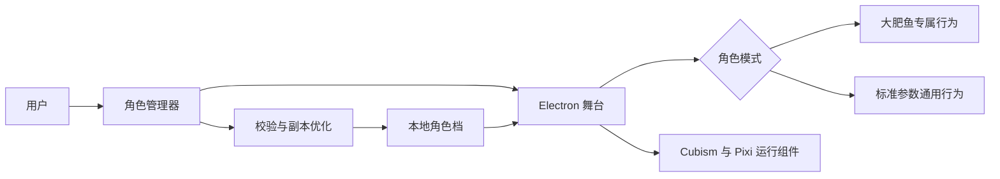

# 架构与开发入口

当前是“Python 管理器 + Electron 舞台”的过渡架构，不是从头实现的 Live2D 引擎。

## 目录

- `tools/pet_manager.py`：导入、角色档、独立设置、本地启停和中文界面。
- `tools/setup.py`：固定上游版本与校验，部署本地修改。
- `source/desktop-v1.1.0/app/main.mjs`：窗口、托盘、设置和本地控制入口。
- `source/desktop-v1.1.0/app/renderer.js`：专属模式与模式分流。
- `source/desktop-v1.1.0/app/generic.js`：标准参数通用模式。
- `source/desktop-v1.1.0/src/stage/`：引擎、动作、表情、物理与互动。
- `source/desktop-v1.1.0/src/server/stage-server.mjs`：只绑定回环地址的模型与控制服务。
- `tests/`：不需要真实模型的导入与安装边界测试。

`models/`、`profiles/`、`data/`、`runtime/` 是运行时生成目录，不进入 Git。控制口令、endpoint、用户动作和偏好均为本地数据。

## 角色适配

已知大肥鱼导出版本按 moc3 SHA256 选择专属模式，避免仅凭文件名误用特殊参数。未知版本或其他角色进入 generic。

通用模式会检查参数存在性并按运行范围限制写入，只使用标准转头、视线、呼吸与眨眼参数。它不是全自动重建绑定，也没有实现任意参数别名映射。

## 下一步重构边界

1. 建立独立的角色能力 schema，明确参数 ID、方向、范围、热区与互斥组。
2. 把大肥鱼硬编码逐步迁入角色适配配置，保持当前可用行为。
3. 将行为规划、时钟与参数写入分开，让待机、互动和语音有统一优先级。
4. 安装、导入、升级使用事务和回滚；避免半成品状态。
5. 梳理 Python/Node 双运行环境，评估是否统一界面；在测量维护成本后决定，不急于全量重写。

## 当前技术债

Electron 33 与上游依赖来自指定运行包，升级和支持状态需单独审查；不应把当前安装流程当成永远无需更新。上游历史开发脚本和文档包含其他环境的路径与测量，仅作为来源材料，不是本项目的运行证明。

安装器目前覆盖列出的舞台改动，升级前应退出桌宠。正式发布前仍需扩展全新环境、DPI、多屏、休眠和长时测试。
