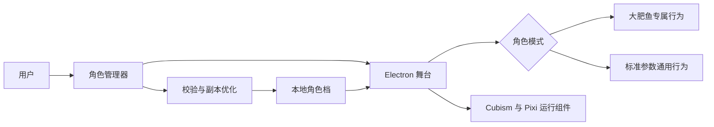

# 架构与开发入口

当前是“Python 管理器 + Electron 舞台”的过渡架构，不是从头实现的 Live2D 引擎。

## 目录

- `tools/pet_manager.py`：导入、角色档、独立设置、本地启停和中文界面。
- `tools/setup.py`：固定上游版本与校验，部署本地修改。
- `source/desktop-v1.1.0/app/main.mjs`：窗口、托盘、设置和本地控制入口。
- `source/desktop-v1.1.0/app/renderer.js`：专属模式与模式分流。
- `source/desktop-v1.1.0/app/generic.js`：标准参数通用模式。
- `source/desktop-v1.1.0/src/stage/`：引擎、动作、表情、物理与互动。
- `source/desktop-v1.1.0/src/server/stage-server.mjs`：只绑定回环地址的模型与控制服务。
- `tests/`：不需要真实模型的导入与安装边界测试。

`models/`、`profiles/`、`data/`、`runtime/` 是运行时生成目录，不进入 Git。控制口令、endpoint、用户动作和偏好均为本地数据。

## 角色适配

已知大肥鱼导出版本按 moc3 SHA256 选择专属模式，避免仅凭文件名误用特殊参数。未知版本或其他角色进入 generic。

通用模式会检查参数存在性并按运行范围限制写入，只使用标准转头、视线、呼吸与眨眼参数。它不是全自动重建绑定，也没有实现任意参数别名映射。

## 目标架构与实施顺序

以 [项目企划书](PROJECT_PLAN.md) 为准，当前目录图描述的是已存在实现，下面是规划的实施顺序；P2 / P3 工程版现已实现，具体范围见文末：

1. P1 先处理安装、启停、导入事务、配置恢复与长时验证。
2. P2 引入独立事件、状态机、任务取消与语义身体契约，通过适配器连接现有舞台。
3. P3 接一个真实对话后端，验证流式输出、打断、用量限制和服务故障降级。
4. P4 增加用户可确认、查看和清空的持久记忆。
5. P5 建立共用时钟与任务的声音链。
6. P6 再完成参数映射和身体工作台，逐步迁移现有硬编码。

拟以 Node/TypeScript 承载新内核，Python 管理器先保留。具体依赖在实施阶段核对；不因新规划而一次性重写现有程序。3D 只预留契约，未实现前不声称可用。

## 当前技术债

Electron 33 与上游依赖来自指定运行包，升级和支持状态需单独审查；不应把当前安装流程当成永远无需更新。上游历史开发脚本和文档包含其他环境的路径与测量，仅作为来源材料，不是本项目的运行证明。

安装器目前覆盖列出的舞台改动，升级前应退出桌宠。正式发布前仍需扩展全新环境、DPI、多屏、休眠和长时测试。

## P1 地基增量

`tools/local_state.py` 提供配置原子写入、备份恢复和跨进程锁；管理器以角色档最后提交作为导入完成边界。舞台 `app/persistence.mjs` 串行保存带版本的设置；`app/placement.mjs` 恢复不可见位置。`local:health` 只返回固定诊断字段，`tools/health_sample.py` 在正常模式记录私人长测证据。部署文件已加入安装器 PATCHES；运行地基验收仍以 [P1 记录](P1_FOUNDATION.md) 为准。

## P2 事件内核（已实现工程版）

`app/kernel/event-kernel.mjs` 由主进程按需创建，处理文字、点击、计时与待机事件。时钟、处理器和身体可注入，不引用模型参数；默认处理器只是本地规则。`stage-adapter.mjs` 使用固定 RPC，`body-port.mjs` 用任务编号和代次拒绝迟到指令，文字层独立于原手动表情和穿戴。`contracts.d.ts` 是类型声明，当前运行使用 ESM，不引入编译工具。

管理器的“内核测试”打开独立窗口；正常启动默认关闭，重载/重启舞台会取消待办。事件日志只保存元数据并轮转，没有持久化聊天或人格。P2 身体只支持文字与停止，其余能力明确不支持。参见 [P2 实施与验收](P2_KERNEL.md)。P1 的恢复与内存增长遗留门槛不因此消失。

## P3 文字对话（真实后端工程版）

`codex-provider.mjs` 按需启动独立官方 App Server，通过已有 ChatGPT 登录请求当前默认可用模型；不提取令牌。`chat-runtime.mjs` 使用同一事件内核与身体代次，串联流式文字、限额、取消和近期上下文。每轮临时后端会话，只在内存保留三轮成功记录，事件日志不含正文。界面区分真实后端与本地测试；点击和待机不发模型请求。

本机 CLI 0.164.0 / gpt-6.1-terra 已完成真实回归。接口属于实验性路径，P3 不代替 P1 长时/恢复收尾或 P4 长期记忆。详见 [P3 文档](P3_CONVERSATION.md)。
